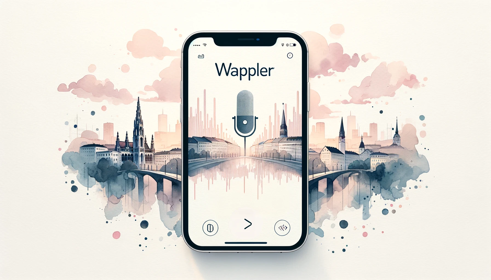

# Wappler - Whatsapp voice transcription  

Mini-project for automatic speech-2-text transcription
of audio files received via a twilio Whatsapp endpoint.
Ready for render deployment & showcasing.

# TODOS:
- finish unit-testing the transcription locally
- finish unit-testing the twilio messaging locally
- check out how the endpoint can be secured against twilio
- resource: https://www.twilio.com/docs/usage/tutorials/how-to-secure-your-flask-app-by-validating-incoming-twilio-requests#use-the-decorator-with-our-twilio-webhooks

# resources:
- OpenAI API for speech 2 text: https://platform.openai.com/docs/guides/speech-to-text/quickstart
- Twilio Python API: https://www.twilio.com/docs/libraries/reference/twilio-python/index.html
- FastApi tutorials for requests: https://medium.com/@mizutori/fastapi-study-diary-4-defining-models-for-request-handling-database-storing-and-response-fe6bb30c0963
- Render deployment stuff: https://www.youtube.com/watch?v=OBGaCULCZzg
- Render env var setup: https://docs.render.com/configure-environment-variables

